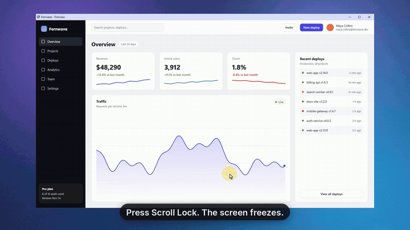

# Snap by rng

Free, open-source screenshot and screen recording tool for Windows. Small and native (Rust, no runtime), opens instantly, stays out of the way, and looks at home in light and dark mode.



▶ **[Watch the demo with sound](docs/media/snap-demo.mp4)** · **[Download the latest release](https://github.com/MRRengi/rng-snap/releases/latest)**

## Install
- **[RengiSnap-Setup.exe](https://github.com/MRRengi/rng-snap/releases/latest)**: installs for your user (no admin prompt), adds Snap to the Start menu, can start it with Windows and adds "Open with Snap" for MP4 and PNG files. Uninstall from Windows Settings like any app.
- **Portable zip**: just the exe, nothing installed.
- After launch the **Home** window shows the three things Snap does with their keys, your latest captures and the few settings (shortcut, save folder, start with Windows). Close it and Snap keeps running in the tray; click the tray icon to bring Home back.

## Screenshots
- **Scroll Lock** freezes every monitor; drag a frame, or click what is highlighted
- **Smart regions**: hover snaps to buttons, cards, panels, rows and windows, in native apps, browsers and Electron apps alike (child windows + UI Automation + pixel boxes for games and canvas apps); the **mouse wheel** walks element > panel > window > monitor
- Loupe with coordinates, frame size and pixel color (**C** copies the hex)
- Instantly on the clipboard; a preview card offers Copy / Save / Save to / Folder / Edit

## Marks and editor
- Hold **Ctrl** when you release the frame and mark it up right on the frozen screen: arrow, line, rectangle, ellipse, pen, marker, text, blur, numbered steps
- **Edit** on the preview card opens the full editor: the same tools plus crop, 8 colors and any custom color, 3 thicknesses, blur or pixelate, undo/redo, zoom
- Arrows with soft shadows, outlined text, numbered circles that count themselves
- Every change goes to the clipboard by itself

## Video
- Up to your monitor's refresh rate (120 / 144 / 240 fps), straight from the GPU into its hardware encoder (H.264, HEVC when needed)
- System sound and microphone, pause, discard; the control bar never appears in the video
- MP4 saved to your folder; Copy puts the file on the clipboard for Telegram / Discord; one-click GIF export

## Video editor
- **Edit** on the video card, **Edit a video** on Home, "Open with Snap" in Explorer, or `RengiSnap.exe --edit file.mp4`
- Cut out pieces (**S** splits at the playhead, **Delete** removes the selected piece, drag an edge to trim), or split out several moments and drag them into a new order
- Text, arrows, boxes, blur, numbered steps and the other editor tools right on the video; each one is a bar on the timeline you can move and stretch
- **Zoom (Z)**: draw an area, the camera glides in and back out
- Thumbnails and the sound wave on the timeline; the preview plays with sound; undo / redo for clips and marks together
- **Export (Ctrl+E)** writes `<name> edit.mp4` next to the original and puts it on the clipboard; **GIF** makes a GIF of the result

## Keys
| Where | Keys |
|---|---|
| Anywhere | **Scroll Lock** capture (press again to stop a recording) |
| Selecting | **Wheel** bigger / smaller region · **Ctrl** + release: mark it up · **C** copy pixel color · **Esc** cancel |
| Marks and editor | **V** select · **A** arrow · **L** line · **R** rectangle · **E** ellipse · **P** pen · **H** marker · **T** text · **B** blur · **N** step · **C** crop (editor) · **Shift** snap to 45° / square |
| Editor | **Ctrl+Z / Ctrl+Y** undo / redo · **Ctrl+C** copy · **Ctrl+S** save · **Ctrl+wheel** zoom · **Ctrl+0** fit · **Ctrl+1** 100% · **Space**+drag pan |
| Quick marks | **Enter** finish and copy |
| Video editor | **Space** play / pause · **S** split · **Delete** remove piece or mark · **Z** zoom · **←/→** frame step (**Shift** 1 s) · **Home/End** · **Ctrl+E** export · **Ctrl+Z / Ctrl+Y** undo / redo |

## Look
- Liquid Glass style: floating glass toolbars that blur what is under them, soft shadows, capsule buttons, Apple system colors
- Follows the Windows light / dark setting, live

## Command line
| Argument | Effect |
|---|---|
| none | Start, or show Home if Snap is already running |
| `--background` | Start in the tray only (used by autostart) |
| `--capture` | Start a capture |
| `--edit <file>` | Open an MP4 in the video editor or a PNG in the editor |
| `--quit` | Close the running Snap |

## Notes
- Windows 10 1809+; Windows 11 recommended (Mica and acrylic glass need Windows 11 22H2+)
- The setup and exe are not signed, so SmartScreen may warn on first run: More info > Run anyway
- Lives in the tray; "Start with Windows" is a switch on Home
- Settings live in `%APPDATA%\Rengi Snap\config.toml`

## Building
```
cargo build --release
```
CI builds on Windows, runs unit tests and an end-to-end test that drives the app on a real desktop (both themes), builds the setup (Inno Setup, `installer/`) and the portable zip, installs and uninstalls the setup to check it, and publishes a release when the version in `Cargo.toml` goes up. The demo video is filmed by CI too (`demo` branch).

MIT license.
